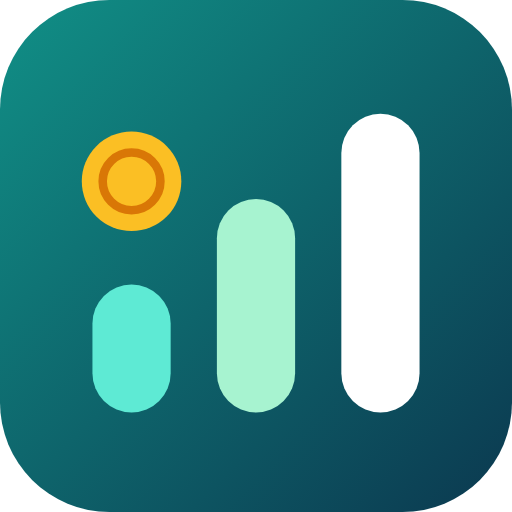
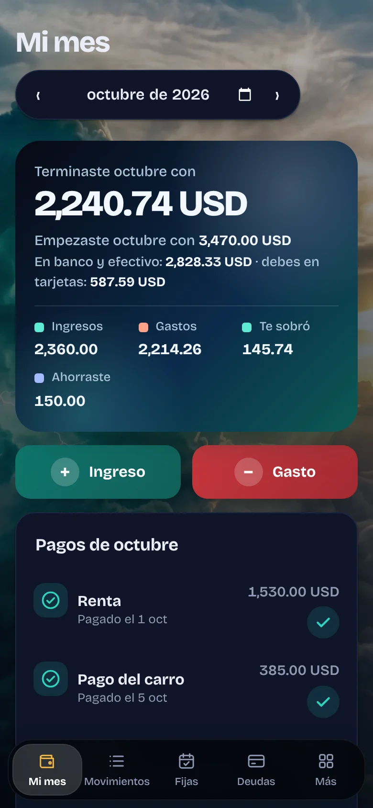
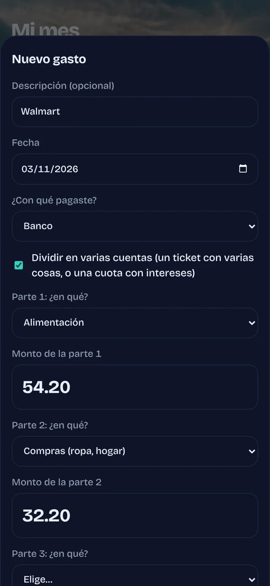
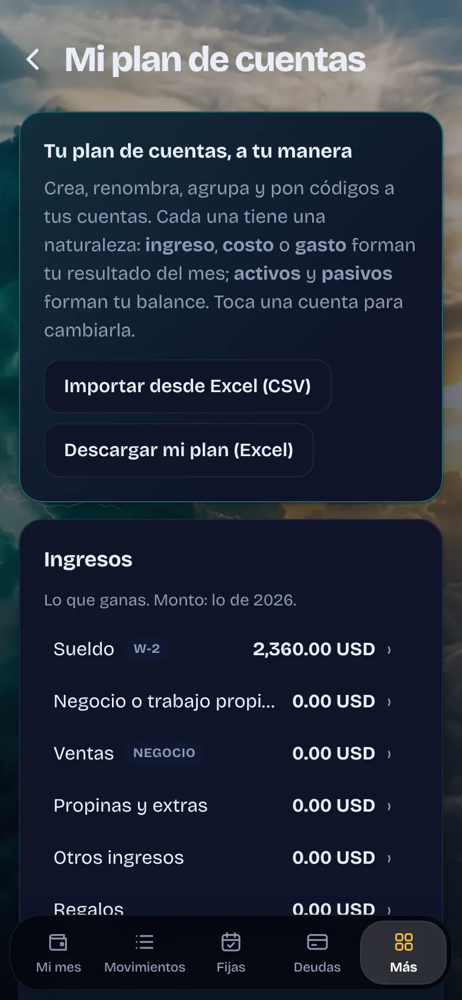
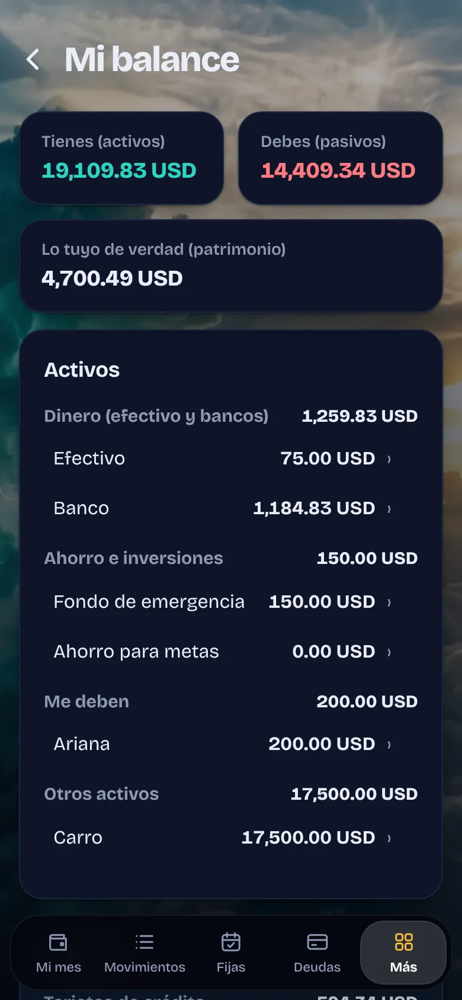
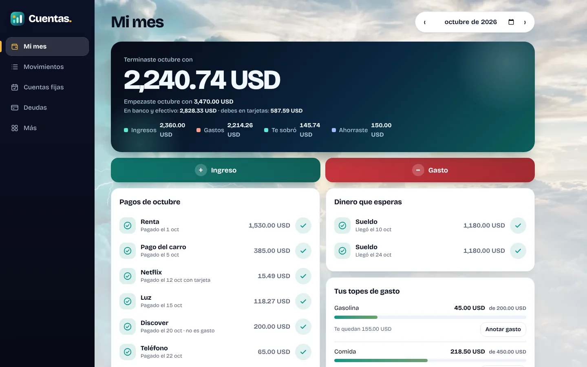

# Cuentas

**Ingresos, gastos y deudas en un solo lugar, con lógica contable y lenguaje sencillo.**

Web, Android y Windows · Versión 4.0

[Abrir Cuentas web](https://yottomtnz.github.io/Cuentas/app/) &nbsp;|&nbsp; [Página de inicio](https://yottomtnz.github.io/Cuentas/) &nbsp;|&nbsp; [Descargas](https://github.com/YottoMtnz/Cuentas/releases)

 

## ES

### Qué es

Cuentas es una app de finanzas personales para llevar lo que entra, lo que sale y lo que debes. Por dentro funciona como una contabilidad de verdad (plan de cuentas, partida doble, balance y estado de resultados), revisada por un contador. Por fuera habla claro: «Libre ahora», «Ingreso», «Gasto».

### Así se ve

<table>
<tr>
<td align="center" width="25%"> <b>Mi mes</b> Resultado del mes y lo que te queda libre</td>
<td align="center" width="25%"> <b>Un ticket, varias cuentas</b> Hasta 6 partes por compra</td>
<td align="center" width="25%"> <b>Plan de cuentas</b> Con tus códigos; se importa desde Excel</td>
<td align="center" width="25%"> <b>Balance</b> Activos, pasivos y patrimonio</td>
</tr>
</table>

Capturas con datos de ejemplo.

### Qué hace

- **Plan de cuentas propio**: ingresos, costos, gastos fijos y variables, activos y pasivos, con códigos. Plantillas Sencilla, Con negocio y Vacía. Importación y exportación en CSV (Excel).
- **Ingresos y gastos** en dos toques, indicando la cuenta de dinero: banco, efectivo o tarjeta. Un ticket se divide hasta en 6 cuentas.
- **Libre ahora**: banco y efectivo menos la deuda de tarjetas. **Resultado del mes**: superávit o déficit.
- **Deudas y préstamos** bien contados: pagar una tarjeta o un préstamo, prestar o ahorrar no es gasto.
- **Balance** y **estado de resultados** mensual, descargables para Excel.
- **Cuentas fijas** con avisos antes del vencimiento en Android y Windows.
- **Importar del banco**: archivos CSV, OFX y QFX.
- **Impuestos de EE. UU.**: estimación del formulario 1040 con las tablas del IRS. Fuera de EE. UU. se ocultan y se elige la moneda.
- **Una cuenta en todos tus equipos**: usuario y contraseña, sincronización y funcionamiento sin conexión.
- **Modo sencillo o contable**, tema claro u oscuro.

### Descargar

| | |
|---|---|
| **Web** | [Abrir Cuentas web](https://yottomtnz.github.io/Cuentas/app/). En iPhone: Safari › Compartir › Agregar a inicio. |
| **Android** | [Cuentas.apk](https://github.com/YottoMtnz/Cuentas/releases/download/v3.0-android/Cuentas.apk). La primera vez, Android pide permiso para instalar desde el navegador. |
| **Windows** | [Cuentas.exe](https://github.com/YottoMtnz/Cuentas/releases/download/v3.0-windows/Cuentas.exe). Si aparece «Windows protegió tu PC»: Más información › Ejecutar de todas formas. |

Las apps avisan cuando hay una versión nueva y la descargan con un toque.

### Tasas fiscales

Este repositorio también hospeda el archivo público que la app descarga para mantener al día sus cálculos: **[`tax-params.json`](https://yottomtnz.github.io/Cuentas/tax-params.json)**.

Contiene, por año, los tramos del impuesto federal sobre la renta, la deducción estándar, el límite de la base del Seguro Social, los montos adicionales para mayores de 65 años y el crédito tributario por hijos. Fuente: IRS ([irs.gov](https://www.irs.gov)). Cuando el año en curso aún no tiene cifras oficiales, la app genera una estimación por inflación y la reemplaza sola al publicarse las definitivas. El campo `app` indica la última versión publicada de Cuentas.

> Las cifras son una estimación orientativa, no asesoría fiscal.

El backend y los constructores de las apps no se publican.

## EN

**Cuentas** is a personal finance app for income, expenses and debts. Under the hood it keeps real books (your own chart of accounts, double entry, balance sheet and income statement), reviewed by an accountant; on the surface it speaks plainly.

- Your own chart of accounts with codes, CSV import and export, and three starter templates.
- Income and expenses in two taps; split one receipt across up to 6 accounts.
- Paying a card or a loan, lending and saving are not counted as expenses.
- Balance sheet and monthly income statement, exportable to Excel.
- Bill reminders on Android and Windows, bank file import (CSV, OFX, QFX).
- US tax estimate (Form 1040) with IRS tables, or hide it and pick your currency outside the US.
- One account on all your devices, with offline support.

**Get it:** [web app](https://yottomtnz.github.io/Cuentas/app/), [Android APK](https://github.com/YottoMtnz/Cuentas/releases/download/v3.0-android/Cuentas.apk), [Windows .exe](https://github.com/YottoMtnz/Cuentas/releases/download/v3.0-windows/Cuentas.exe).

This repository also hosts the public tax-rates file the app downloads: [`tax-params.json`](https://yottomtnz.github.io/Cuentas/tax-params.json) (federal brackets, standard deduction, Social Security wage base, 65+ amounts and child tax credit per year, sourced from the IRS). Figures are a guidance estimate, not tax advice. The backend and the app builders are not published.

---

Hecho con ♥ por [Fraudy Martinez](https://github.com/YottoMtnz)

